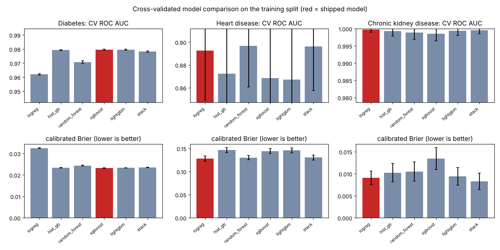
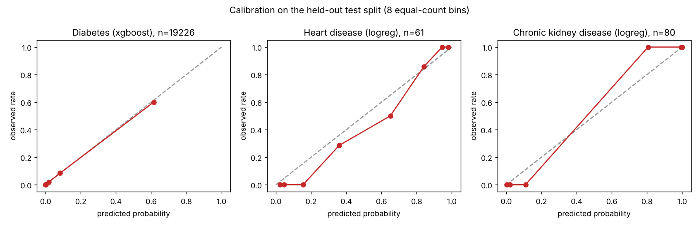

# Prognosis

**Know the risk. See the reason.**

Prognosis is a small clinic tool that estimates the risk of three conditions (diabetes, heart disease and chronic kidney disease), explains each estimate, keeps a history for every patient and produces a PDF report. It is decision support built on public research datasets, not a medical device.

## How it helps

A risk number on its own is hard to act on. Prognosis shows which inputs pushed an estimate up or down, in percentage points of probability, sorts patients into low, moderate and high bands, and tracks how a patient changes from visit to visit. The report is ready to hand to the patient. Everything is scoped to the clinic that owns the data.

## What it does

- Estimates risk for diabetes, heart disease and chronic kidney disease from a short clinical form.
- Explains each estimate with Shapley values for the original clinical inputs, not for one-hot columns. They add up exactly to the prediction minus the background average.
- Places each patient in a low, moderate or high band, with the observed event rate for each band stored in the model card.
- Keeps a visit history per patient with trend summaries and a clinic dashboard.
- Produces a PDF report with advice text. An optional language-model rewrite is off by default, sends only clinical values (never name or MRN) and falls back to the rules text on any failure.
- Supports several clinics. Every query is scoped to the caller's clinic, and another clinic gets a 404.

## How it works

```
Streamlit UI  --http-->  FastAPI  -->  SQLAlchemy (SQLite, any SQL database works)
                           |
                           +-->  Predictor  -->  models/<condition>/{model.joblib, card.json}
                           +-->  advice (rules text, optional LLM rewrite)  +  PDF report
```

1. The form is built from one description of every input (`prognosis/ml/spec.py`): label, unit, allowed range, options, required or optional. The trainer, the API validation and the UI forms all read it, so they always agree.
2. Inputs are validated before they reach a model. Unknown fields, out-of-range values, NaN and wrong options are rejected with all problems listed at once. Empty optional fields are filled by the pipeline's own imputer, fitted on training data. Values outside the range seen in training produce a warning on the result.
3. The model returns a calibrated probability, a band and a Shapley explanation.
4. The result is saved to the patient's history, and the PDF report is generated from it.

## Training

For each condition the same procedure runs (`python -m prognosis.ml.train`):

1. A stratified 80/20 split with a fixed seed. The 20% is used once, at the end.
2. Six candidates on the training part with repeated stratified 5-fold cross-validation: logistic regression, histogram gradient boosting, random forest, XGBoost, LightGBM, and a stacked hybrid (logistic regression, gradient boosting and random forest blended by a logistic regression on out-of-fold predictions).
3. Each candidate's probabilities are checked for calibration. Sigmoid or isotonic calibration is kept only if it lowers the Brier score.
4. Selection: lowest calibrated Brier score, but anything within one standard error of the best counts as tied and the simplest tied model wins.
5. Risk bands come from out-of-fold scores. The low cut keeps 95% sensitivity (never above 0.30) and the high cut keeps 95% specificity.
6. Test metrics with bootstrap confidence intervals, permutation importance, and the observed event rate inside each band.

A model is a folder: the fitted pipeline, a `card.json` with everything measured about it, and a small background sample used for explanations.

## Results

Cross-validated on the training split (mean over folds). The shipped model for each condition is in bold.

| Condition | Model | CV ROC AUC | Calibrated Brier |
|---|---|---|---|
| Diabetes (76,902 train rows, 5-fold x1) | logistic regression | 0.962 | 0.0325 |
| | hist gradient boosting | 0.979 | 0.0234 |
| | random forest | 0.971 | 0.0244 |
| | **XGBoost** | 0.980 | 0.0232 |
| | LightGBM | 0.980 | 0.0233 |
| | stack (hybrid) | 0.978 | 0.0235 |
| Heart (242 train rows, 5-fold x5) | **logistic regression** | 0.893 +/- 0.044 | 0.1281 |
| | hist gradient boosting | 0.872 | 0.1464 |
| | random forest | 0.897 | 0.1302 |
| | XGBoost | 0.869 | 0.1443 |
| | LightGBM | 0.867 | 0.1460 |
| | stack (hybrid) | 0.896 | 0.1305 |
| Kidney (319 train rows, 5-fold x5) | **logistic regression** | 0.9997 | 0.0091 |
| | hist gradient boosting | 0.9993 | 0.0103 |
| | random forest | 0.9989 | 0.0105 |
| | XGBoost | 0.9986 | 0.0135 |
| | LightGBM | 0.9994 | 0.0094 |
| | stack (hybrid) | 0.9995 | 0.0083 |

Shipped models on the untouched test split:

| Condition | Test rows | ROC AUC (95% CI) | Brier | Plain logistic regression AUC |
|---|---|---|---|---|
| Diabetes | 19,226 | 0.978 (0.975 to 0.980) | 0.0233 | 0.960 |
| Heart | 61 | 0.965 (0.922 to 0.995) | 0.080 | 0.965 (same model) |
| Kidney | 80 | 1.000 (1.000 to 1.000) | 0.011 | 1.000 (same model) |

Observed event rate inside each risk band on the test split. It climbs from low to high for every condition:

| Condition | Low | Moderate | High |
|---|---|---|---|
| Diabetes | 0.6% of 15,388 | 10.8% of 1,432 | 60.0% of 2,406 |
| Heart | 0% of 20 | 37% of 19 | 95% of 22 |
| Kidney | 0% of 29 | 0% of 1 | 100% of 50 |

For diabetes, HbA1c ranks first in permutation importance and blood glucose second. Charts are in `docs/model_comparison.png` and `docs/calibration.png`.





## Security and privacy

- Passwords are hashed with argon2, logins are throttled, and tokens are short-lived JWTs.
- Every query is scoped to the caller's clinic.
- Security-relevant actions go to an audit log.
- There is no default account. The first admin comes from environment variables or `python -m prognosis.cli create-admin`.

## Tech stack

Python, scikit-learn, XGBoost, LightGBM, pandas, NumPy, FastAPI, SQLAlchemy, Streamlit, Plotly, argon2 and PyJWT for security, fpdf2 for reports, Docker, pytest.

## Run it

```
pip install -r requirements.txt
python -m prognosis.ml.train                    # trains all three, about 20 minutes on 2 cores
python -c "import secrets; print(secrets.token_urlsafe(48))"   # use the output as the JWT secret

export PROGNOSIS_JWT_SECRET=...                 # see .env.example for everything else
python -m prognosis.cli create-admin --username admin
uvicorn prognosis.api.app:app_factory --factory --port 8000
streamlit run prognosis/ui/app.py
```

`python -m prognosis.demo` adds eight clearly fictional patients with three diabetes visits each, so the dashboard and trend pages have something to show. `python -m prognosis.ml.train --quick` is a two-model smoke run. `python -m prognosis.ml.train --rethreshold` recomputes only the band cut points of saved models. `python scripts/make_docs.py` redraws the charts from the saved models.

With Docker: `docker compose up --build`.

The datasets are in `data/raw/`: the Kaggle diabetes prediction dataset, the UCI Cleveland heart disease data and the UCI chronic kidney disease data. Check each source's own terms before reusing them.

## Build and test

```
pip install -r requirements-dev.txt
pytest
```

The tests cover data loading and cleaning, every candidate model with missing values, metrics, band thresholds, the Shapley estimator (additivity and finding the real driver), input validation, and the API: auth, lockout, expired tokens, clinic separation, the audit log, PDF output, trends and the dashboard.

## Layout

```
prognosis/ml/        spec, data loading, candidates, evaluation, training, explanations, predictor
prognosis/api/       FastAPI app, schemas, dependencies
prognosis/db/        SQLAlchemy models and sessions
prognosis/services/  security, advice text, PDF report, trend summary
prognosis/ui/        Streamlit app and API client
models/              trained models and their cards
data/raw/            the three datasets
tests/  scripts/  docs/  assets/fonts/
```

## More

Notes on the results and on running it: [docs/notes.md](docs/notes.md).

## License

MIT for the code. The DejaVu fonts in `assets/fonts/` keep their own license file.
